# 任务 / Git 生命周期

工作区模式（none / direct / worktree）与审查模式（none / agent / human）独立建模。旧任务没有 lifecycle 字段，不移动 cwd、不追溯创建 worktree。只读调查、提醒等显式 `kind=read_only` 免 Git，即使讨论支付/权限也不执行修改。

```mermaid
stateDiagram-v2
 [*] --> preparing
 preparing --> developing: prepare 成功并启动 worker
 developing --> quiescing: 开发完成（不是最终 done）
 quiescing --> reviewing: worker 退出，固定 head SHA
 quiescing --> integrating: A
 reviewing --> changes_requested: 不通过
 changes_requested --> developing: 原 session / 原 worktree
 reviewing --> human_approval: C
 reviewing --> integrating: B 通过
 human_approval --> integrating: 人类明确批准同一 SHA
 integrating --> developing: 基线前进 / 冲突，重审
 integrating --> ci: PR 创建/复用，等待 CI/审批
 ci --> developing: CI 失败 / 基线更新
 ci --> cleanup: 确认远端 merge 且包含任务 SHA
 integrating --> cleanup: 直接 push，远端确认包含 SHA
 cleanup --> complete: dev 安全 FF、无 worker、清理成功
 complete --> [*]: 最终 done，待扫；Release 单独追踪
 complete --> preparing: 追加需求，新一轮工作区
```



## 策略

前台提供 `lifecycle: {kind,risk,complexity,reason}` 自动判断，不让用户每次选。hub 按项目强制规则 > 具体风险 > 复杂度 > 快速前端意图 > 工作区安全应用策略。

- **A**：明确 `risk=low, complexity=small_frontend`。已确认实际 dev 主目录、主分支与远端同步、无其他任务占用才直改。HMR 即时可见；不自动 `git add .`、stash、reset。允许保留无关既有脏改动，但任何任务提交触碰既有脏路径都会拒绝集成。无独立 review；测试后直接 push。
- **B**：编码默认隔离 `task/<id>`；复杂/跨模块/后端都走独立进程对抗性审查。hub 只接受明确 head SHA 的 verdict；修改交回原 worker/session/worktree。基线前进则交回合入、测试并重新 review。
- **C**：支付/账务/金额/密钥/重要权限/不可逆操作（包括前端里的这些逻辑）先 Agent review，再展示行为、资金/数据/权限影响、测试、风险/回滚、具体批准事项。只有明确批准该 SHA 才集成，规模本身不触发人工。

提交路径和 diff 暴露关键风险会自动升级 C。worker 可用 `qa_scope` 提前报告范围扩大；隔离任务就地升级，A 发现范围扩大立即暂停并保留改动。**A 的未提交改动自动搬迁尚未实现**，不能猜哪些脏文件属于任务；必须明确处理归属/迁移后继续，重试不绕过此保护。

前台判断不是 OS 沙箱。hub 的 worker token 仅可报告/订阅/评论自身任务，不可批准、配置或任意 RPC；reviewer 不继承 worker 身份，禁用扩展/MCP，只有只读文件工具。已有同一 OS 用户仍可访问 Git/配置，不应把本工具当恶意代码沙箱；生产支付/部署执行不属于此机制。

## 配置

在 `config.json` 添加可信项目规则（前台的自动判断仍由规则兜底）：

```json
{
  "lifecycle": [{
    "cwd": "/absolute/actual-dev-checkout",
    "baseBranch": "main",
    "test": ["npm", "test"],
    "integration": "direct",
    "integrationCoordinator": "cloud"
  }]
}
```

- `cwd` 是确认的实际 dev 主目录；相同机器下匹配任务 cwd。无需猜生产部署命令。无规则时能安全从 Git worktree 元数据发现主目录供隔离准备，但不假定它就是 HMR 服务目录，A 升级 B。
- `test` 是可信 argv（不是 worker 提供的 shell）。缺少测试配置时开发/review 可以进行，但自动集成失败关闭。配置补好后重试可从原阶段继续。
- `forceHuman:true` / `defaultReview:"human"` 强制 C；`defaultReview:"agent"` 禁用 A。
- `integration:"pr"` 还需 `githubRepo:"owner/name"`、明确 `baseBranch`，可设 `githubApi` 供 GitHub Enterprise；凭证取 hub 的 `GH_TOKEN`，不存任务字段。
- Mesh 开启时所有参与机器必须为同一 repo 配同一个 `integrationCoordinator`，缺失或不可达则不能自动集成。非 Mesh 默认本机。coordinator 使用持久化无过期 repo+目标分支互斥锁，不因网络分区偷锁。锁同一 machine/task 幂等；重启可恢复原任务并释放，取消/失败不删改动。

## 直接合并、PR 与恢复

直接合并只在远端基线是已审 SHA 祖先时测试该真实结果并普通 push，永不 force。push 回执丢失先查远端；远端已含 SHA 不重测/重推。PR 分支发布也不 force，已有 open PR 按 head/base 查找复用；创建不是 done。CI 必须有实际成功证据，分页不完整/未知态/审批等待均不当通过。CI 失败或基线推进返回 worker，修复提交后重审。

自动 PR merge 还要从 GitHub 确认目标分支启用了 **strict/up-to-date required-CI**（防止测试后 base 竞态），无查询权限/无该保护就阻止自动合并。使用 merge commit 保留已审 SHA，GitHub 明确 merged 后再 fetch 目标确认祖先关系。Squash/rebase merge 不会被冒充为通过，需保留工作区核实。当前不自动 Draft、merge queue 或删除远端任务分支；远端分支保留避免删除并发新提交。

生命周期、review/approval SHA、PR、coordinator lease 均持久化在 task.json，写入原子替换。清理有独立回执，可恢复“worktree 删除成功但分支删除失败”。清理失败仅重试清理。取消/失败不删除工作区；清理前验证远端、worker 退出、脏/未跟踪/**ignored**文件，绝不强删。ignored 构建产物也保留，因此安装 node_modules 或生成缓存可能需要项目自行明确清理后重试，而不是 hub 擅自删除。dev 主目录脏或分支不同则不覆盖、保留 worktree 并报告已推送但待同步。

注意力与生命周期分离：准备/开发/Agent审查/CI/自动集成均 running、不打扰；人工 gate/无法自修 blocked 才需要人。集成清理完成 done 待扫。Release 展示独立说明，不等 Release 或客户端安装、不自动升级服务。

## 操作与验证

- `quick approve <id> --sha <完整 SHA>` / UI「批准当前 SHA」/ 前台 `qa_task_review`：仅任务验收人/请求人或 root，可转达人类明确决策。
- `quick changes <id> <要求>`：暂停态要求修改，旧批准失效。普通「追加」不能代替关键批准。
- 阶段、策略理由、head、review、PR、Release 在详情展示，列表按创建时间稳定排序，不因 activity/status 更新跳动。
- `npm test`：临时 Git/bare remote，真实隔离 hub + mock tmux/pi，mock GitHub；不运行真实任务或真实服务。独立 reviewer 只读审查实现。
- 当前 main 没有 progress/expect/watchdog 源模块（运行版本可能来自独立 worktree）；新增生命周期 patch 保留其他任务扩展字段，未另造冲突协议。
